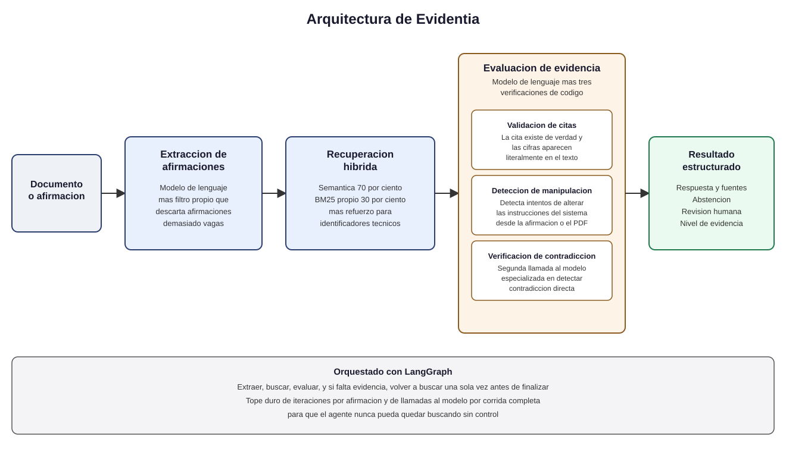
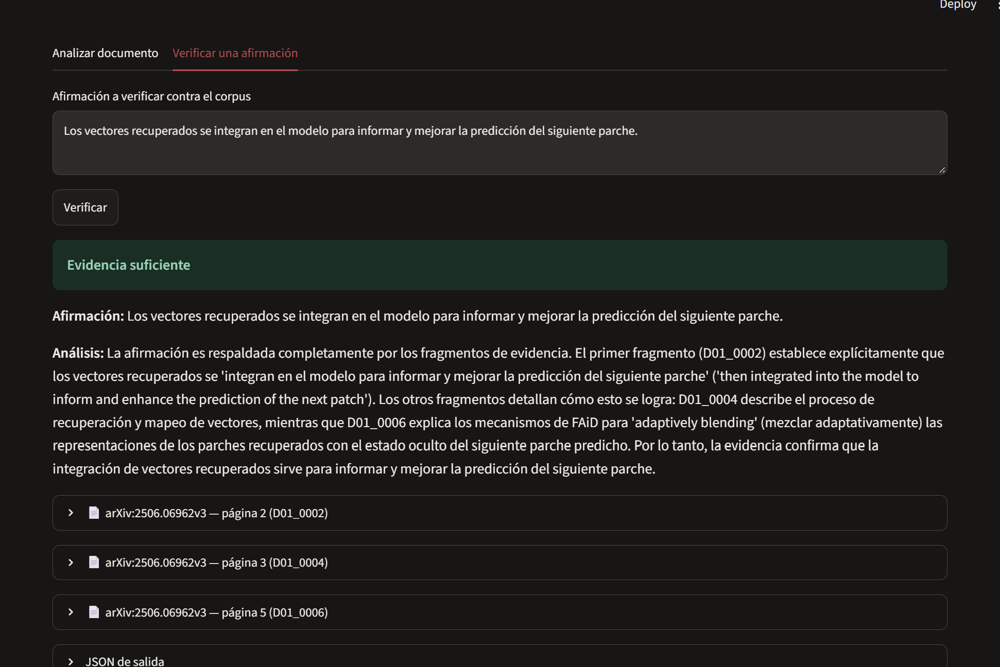
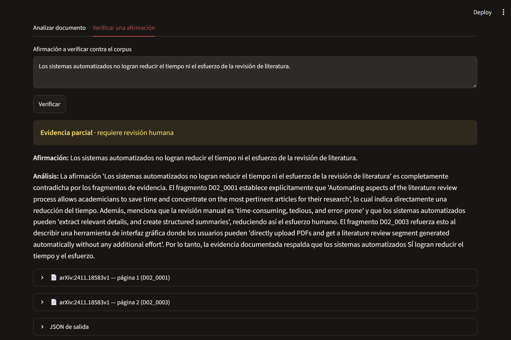
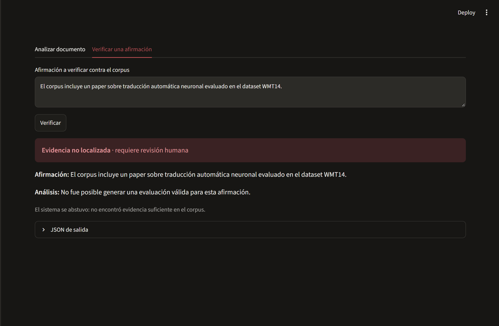

# Evidentia

Sistema inteligente de análisis y trazabilidad de evidencia en documentos académicos.

Proyecto final del curso CC3103, Procesamiento de Lenguaje Natural, Universidad del Valle de Guatemala.

## Qué hace

Evidentia analiza afirmaciones presentes en documentos académicos y evalúa si cuentan con evidencia de respaldo dentro de un corpus de fuentes documentales autorizadas, usando procesamiento de lenguaje natural, recuperación aumentada de información y un flujo agéntico. Cada resultado incluye los fragmentos y las referencias documentales usados, de modo que el propio usuario pueda verificarlos.

## Video de demostración

[Ver la demostración en video](https://canva.link/rzpmkv3vawo5fsl)

## Arquitectura



## Estructura del repositorio

```
data/
  raw/        PDFs originales del corpus (no versionados, ver .gitignore)
  processed/  documents.json (metadata, versionado) y chunks.jsonl (texto, no versionado)
  eval/       Banco de pruebas de evaluación
src/
  ingestion/  Carga, extracción, limpieza y segmentación de documentos, fuente de arXiv
  retrieval/  Embeddings, índice vectorial, búsqueda híbrida
  agent/      Orquestador, herramientas del agente y cliente del modelo de lenguaje
  schemas/    Modelos Pydantic de metadatos y del esquema de salida obligatorio
scripts/      Scripts de uso manual (armar el corpus, probar el modelo de lenguaje)
app/          Interfaz Streamlit
tests/        Pruebas unitarias y de integración
```

## Documentos del repositorio

| Archivo | Para qué sirve |
|---|---|
| `STATUS.md` | Fotografía del estado actual del proyecto, con lo que ya está listo, lo que falta de verdad y por dónde conviene retomar el trabajo. Conviene leerlo primero si se vuelve al proyecto después de un tiempo. |
| `TODO.md` | Lista de tareas pendientes, organizada según las seis fases del curso (anteproyecto, línea base, mejora técnica, evaluación, seguridad, y demostración y defensa). |
| `DECISIONS.md` | Registro de decisiones de diseño e iteraciones, con el contexto de cada una, qué se decidió, qué alternativas se consideraron, su estado y los vacíos que quedan abiertos. Es la base de las secciones de limitaciones y trabajo futuro del documento técnico final. |
| `DOCUMENTO_TECNICO.md` | Documento técnico final del proyecto. |
| `PLAN_DE_TRABAJO.md` | Plan de trabajo real, con responsables y fechas tomados del historial de control de versiones, pensado para copiarse a la sección de plan de trabajo del anteproyecto. |
| `GUION_DEMO.md` | Guion de la demostración en vivo. |
| `CLAUDE.md` | Reglas de trabajo para Claude Code dentro de este repositorio. |
| `requirements.txt` | Dependencias de Python del proyecto. |

## Preparación del entorno

El proyecto usa un entorno de conda y no un `venv` convencional. Como se explica en `DECISIONS.md`, la copia de `torch` instalada mediante `pip` dentro de un `venv` quedó bloqueada por el Control de aplicaciones de Windows, mientras que la instalada mediante `conda` no presenta ese problema.

```powershell
conda create -n evidentia python=3.12 -y
conda install -n evidentia pytorch cpuonly -c pytorch -y
conda activate evidentia
pip install -r requirements.txt
```

Si en una máquina particular la versión de `pytorch` del canal `pytorch` resulta incompatible con `transformers`, que exige `torch >= 2.6`, conviene instalar una compilación más reciente como la siguiente.

```powershell
conda search "pytorch[version='>=2.6']" -c pytorch
conda install -n evidentia pytorch=2.15.0 -c pytorch -y
```

Para correr cualquier script del proyecto conviene usar el Python de este entorno.

```powershell
C:\Users\<usuario>\anaconda3\envs\evidentia\python.exe scripts\build_corpus.py
C:\Users\<usuario>\anaconda3\envs\evidentia\python.exe -m pytest tests/
```

También puede activarse el entorno primero con `conda activate evidentia` y usar `python` o `pytest` directamente.

## Cómo regenerar los datos localmente

Ni los PDFs originales (`data/raw/`) ni el texto completo extraído de los chunks (`data/processed/chunks.jsonl`) se suben a git, porque el contenido de artículos de terceros no debe redistribuirse por ese medio, según se documenta en `DECISIONS.md`. Lo único versionado es `data/processed/documents.json`, que contiene solamente metadata bibliográfica.

Quien clone el repositorio desde cero puede obtener los datos localmente corriendo lo siguiente.

```powershell
conda activate evidentia
python scripts\build_corpus.py
```

Esto descarga los diez artículos iniciales de arXiv a `data/raw/`, los procesa con el flujo de ingesta y regenera `data/processed/documents.json` y `chunks.jsonl`. El proceso es reproducible, porque siempre arma el mismo corpus a partir de las mismas consultas y del mismo filtro de duplicados y tamaño, salvo que arXiv cambie qué resultados considera más relevantes para esas búsquedas.

## Uso del modelo generativo con LM Studio

El sistema necesita un modelo de lenguaje para evaluar afirmaciones contra la evidencia recuperada. Por defecto, el proyecto está configurado para usar LM Studio corriendo en la propia máquina, de forma gratuita y privada, sin necesidad de una clave de API. El porqué de esta decisión está explicado en `src/agent/llm_client.py` y en `DECISIONS.md`.

### Primero, instalar LM Studio

Se descarga de [lmstudio.ai](https://lmstudio.ai) y se instala de la forma habitual.

### Segundo, descargar un modelo

Dentro de LM Studio, en la pestaña de búsqueda, conviene buscar un modelo de tipo instruct que trabaje solamente con texto, no uno de la variante "VL" o de visión y lenguaje, ya que estos reservan capacidad para imágenes y razonan peor sobre texto puro. Se recomienda `qwen/qwen3.5-9b`, el modelo que usa este repositorio en sus pruebas. Como se documenta en `DECISIONS.md`, la variante de visión y lenguaje de 7000 millones de parámetros fallaba de forma irresoluble por prompt en casos de contradicción, mientras que este modelo de texto de 9000 millones de parámetros resolvió el problema con el simple cambio de modelo. El modelo elegido debe soportar salida estructurada mediante JSON Schema, algo que la mayoría de los modelos instruct recientes de Qwen, Llama o Mistral ya soporta.

### Tercero, levantar el servidor local

Hay dos formas de hacerlo y cualquiera de las dos funciona.

Desde la aplicación, se abre la pestaña del servidor local, identificada con el ícono `<->`, se elige el modelo descargado y se presiona "Start Server". El servidor queda escuchando en `http://localhost:1234`.

Desde la terminal, de forma más rápida y sin necesidad de abrir la ventana de LM Studio, se corre lo siguiente.

```powershell
lms server start
lms load qwen/qwen3.5-9b --context-length 16384
lms status
```

El último comando confirma que el servidor está activo y que el modelo quedó cargado. Es importante usar `--context-length 16384` o un valor mayor, porque con el contexto por defecto de 4096 tokens el sistema falla cuando se recuperan cinco fragmentos de evidencia, ya que cinco fragmentos de unas 450 palabras cada uno, sumados al resto del mensaje, superan ese límite, como se explica en `DECISIONS.md`. Conviene además verificar con `lms ps` que la columna de contexto efectivamente muestre 16384, porque cargar un modelo que ya estaba cargado no siempre aplica el nuevo valor.

El ejecutable `lms` se instala junto con LM Studio, por lo general en `%USERPROFILE%\.lmstudio\bin\lms.exe`.

### Cuarto, configurar las variables de entorno

Se copia `.env.example` a `.env` y se ajusta `LLM_MODEL` al identificador exacto del modelo cargado, el mismo nombre que se usó en `lms load`.

```bash
copy .env.example .env
```

```
LLM_BASE_URL=http://localhost:1234/v1
LLM_API_KEY=lm-studio
LLM_MODEL=qwen/qwen3.5-9b
```

### Quinto, probar que todo funciona

```powershell
conda activate evidentia
python scripts\check_llm.py
```

Si todo está bien, el script imprime un `EvidentiaOutput` válido, con su clasificación y sus fuentes, en lugar de la respuesta de abstención por fallo. Si falla, conviene revisar que el servidor esté activo mediante `lms status` y que `LLM_MODEL` coincida exactamente con el modelo cargado.

### Nota sobre el SDK de OpenAI

El proyecto no usa el SDK oficial de `openai`, sino que habla directamente por REST usando la biblioteca `requests`. Esto se debe a que, en Windows, el SDK falló por culpa de un binario nativo llamado `jiter`, que quedó bloqueado por el Control de aplicaciones de Windows. Si en algún momento se cambia de proveedor, por ejemplo hacia una API en la nube en lugar de LM Studio, basta con cambiar las variables de entorno sin tocar el código, siempre que ese proveedor también soporte el formato de respuesta `json_schema`, como se detalla en `DECISIONS.md`.

## Interfaz

```bash
conda activate evidentia
streamlit run app/streamlit_app.py
```

Requiere que el servidor de LM Studio esté activo, según se describe arriba, y que el corpus ya exista en `data/processed/chunks.jsonl`, lo cual se logra corriendo `python scripts/build_corpus.py`.

## Ejemplos de uso

Las siguientes capturas muestran la pestaña de verificación de una afirmación suelta, con el modelo `qwen/qwen3.5-9b` corriendo de forma local, para los tres niveles de evidencia que el sistema puede asignar.



La afirmación de este primer ejemplo está tomada casi textualmente de uno de los documentos del corpus. El sistema la clasifica como evidencia suficiente y cita tres fragmentos distintos del mismo documento, cada uno con su página y su identificador de fragmento, de modo que la fuente original puede revisarse directamente.



Esta segunda afirmación se redactó a propósito en el sentido contrario a lo que dice el documento. El sistema detecta que los fragmentos recuperados en realidad contradicen la afirmación, en lugar de respaldarla, así que la clasifica como evidencia parcial y marca que necesita revisión humana, sin importar que las palabras de la afirmación coincidan superficialmente con el tema del documento.



Esta última afirmación trata un tema ausente del corpus. En lugar de forzar una respuesta, el sistema se abstiene, no cita ninguna fuente y marca igualmente que necesita revisión humana. Este comportamiento de abstención ante falta de evidencia es un principio de diseño central del proyecto, descrito con más detalle en `DECISIONS.md`.

## Integrantes

- Mónica Salvatierra (22249)
- Bianca Calderón (22272)
